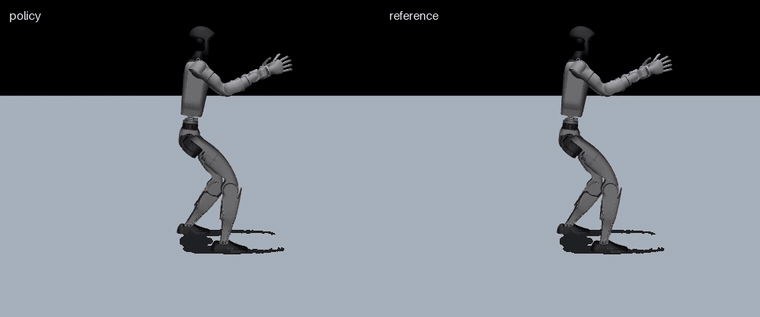
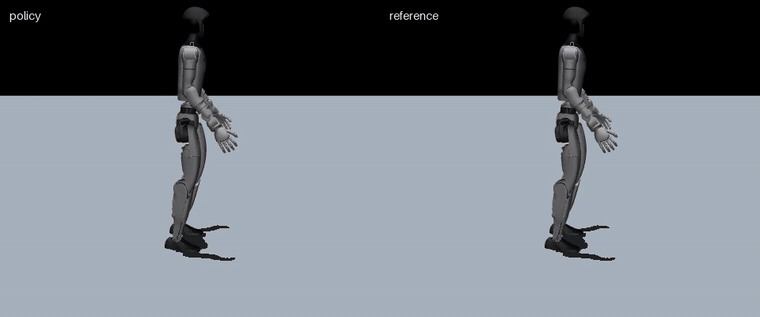
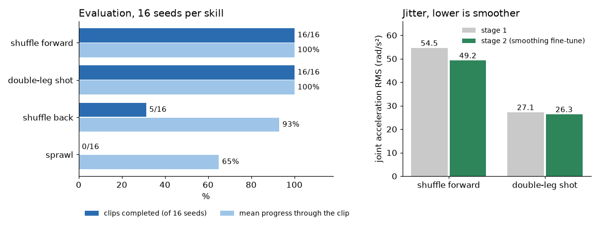
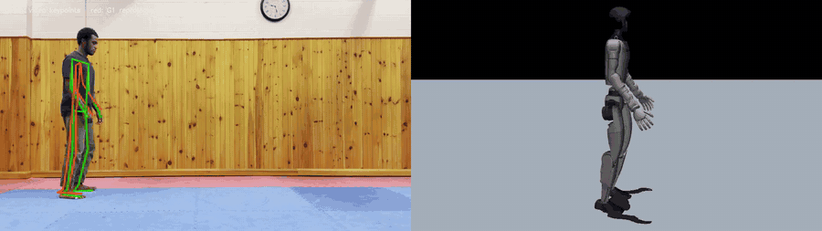
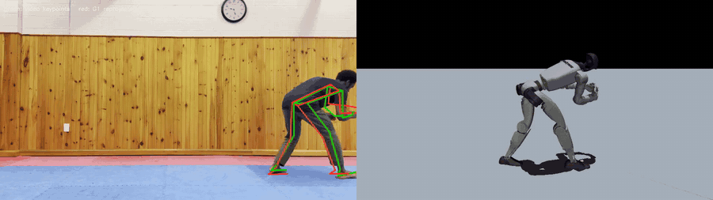
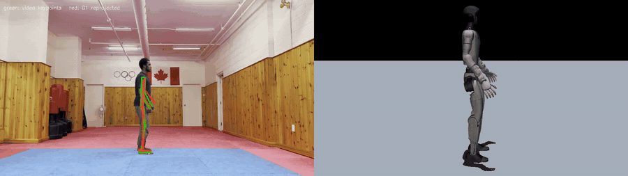

# Wrestling

Teaching a Unitree G1 humanoid wrestling footwork and shots from phone video. A pose pipeline turns a
clip of me drilling into a G1 reference motion, and a PPO imitation policy learns to perform it in
MuJoCo physics with soft, human-like joint gains. Everything trains on CPU.

<p align="center">
  <br>
  <em>Double-leg shot: trained policy in physics (left), reference motion (right)</em>
</p>

<p align="center">
  <br>
  <em>Forward shuffle: trained policy (left), reference retargeted from video (right)</em>
</p>

## Results

Each skill is evaluated with the deterministic policy from the first frame of the clip over 16 seeds
(seed 0 starts exactly on the reference, the others add small joint and root noise). A rollout
counts as complete when it reaches the end of the clip without falling.

| Skill | Reference | Completed | Mean progress | Joint MSE (rad²) | Status |
|---|---|---|---|---|---|
| Shuffle forward | video | 16/16 | 100% | 0.057 | done, checkpoint included |
| Double-leg shot | hand-keyed | 16/16 | 100% | 0.025 | done, checkpoint included |
| Shuffle back | video | 5/16 | 93% | | in progress |
| Sprawl | video | 0/16 | 65% | | in progress |

<p align="center"></p>

Both finished policies were trained in two stages:

1. **Imitation** (`configs/skills/shuffle_forward.json`, `configs/skills/double_leg.json`). The shot
   is trained with random ±20° heading changes so the policy does not depend on facing one direction.
2. **Smoothing fine-tune** (`*_smooth.json`), starting from the stage 1 checkpoint with a very low
   learning rate and small penalties on action rate, action jerk and joint acceleration. This lowered
   the joint-acceleration RMS from 54.5 to 49.2 rad/s² on the shuffle and from 27.1 to 26.3 on the shot,
   and lifted the shot from 15/16 to 16/16.

## From video to robot

<p align="center">
  <br>
  <br>
  <br>
  <em>Green: MediaPipe keypoints. Red: the retargeted G1 projected back into the video through the fitted camera.</em>
</p>

1. **Pose.** MediaPipe Pose (heavy) gives 2D keypoints and metric 3D landmarks per frame. A second
   pass on a person-centred crop of the full-resolution frame adds detail when the body is small or low.
2. **Lift and ground.** Keypoints are lifted with a pinhole model (depth from apparent body size), the
   mat plane is fitted to the lowest contact points, and left/right label swaps are fixed over time.
   Foot and hand contacts are labelled from the 2D video alone.
3. **Retarget.** The body is scaled to G1 leg length and an inverse-kinematics solve fits the G1's 29
   joints and floating base to the keypoints and bone directions, within joint limits. Planted soles
   are kept flat on the mat, the centre of mass is kept over the feet, and limbs hidden behind the body
   follow the mirrored visible limb.
4. **Gate.** The result is projected back into the video through a fitted camera and checked for
   reprojection error, contact agreement, limb directions, floor penetration and joint acceleration.
   The three video references above reproject to within 3.1 to 4.3% of body height on average.
5. **Imitation RL.** PPO tracks the reference in MuJoCo (DeepMimic-style): bounded tracking rewards for
   pose, keypoints, root and contacts, reference state initialisation and early termination on falls.
   Safety terms (forbidden body contact, self-collision, joint limits, torque spikes, jerk, foot slip)
   are costs with Lagrange multipliers rather than hand-tuned penalties. The actuators are soft PD
   servos ([`configs/gains/g1_soft.json`](configs/gains/g1_soft.json)) with a feedforward torque from
   the reference motion's inverse dynamics, so the robot moves compliantly instead of stiffly snapping
   to targets.

## Quick start

Tested on Linux with Python 3.13 (set `PYTHON=` to choose the interpreter).

```bash
scripts/setup.sh            # .venv with pinned dependencies + the Unitree G1 model from MuJoCo Menagerie
source .venv/bin/activate
python -m unittest          # checkpoints still complete their clips
```

Evaluate and render the included checkpoints:

```bash
python -m wrestling.evaluate configs/skills/double_leg_smooth.json checkpoints/double_leg.npz
python -m wrestling.evaluate configs/skills/shuffle_forward_smooth.json checkpoints/shuffle_forward.npz

MUJOCO_GL=egl python -m wrestling.render configs/skills/double_leg_smooth.json checkpoints/double_leg.npz --out double_leg.mp4
```

(`MUJOCO_GL=egl` is for headless Linux; leave it out on a desktop.)

Train from scratch, then fine-tune:

```bash
python -m wrestling.train configs/skills/double_leg.json --out runs/double_leg
python -m wrestling.train configs/skills/double_leg_smooth.json --init runs/double_leg/best.npz --out runs/double_leg_smooth
```

Training uses one CPU process per worker (`--workers`, default from the config) and stops after the
config's time budget (`--minutes` to override). Logs go to `runs/<name>/train.jsonl`; `best.npz` is the
checkpoint with the best evaluation.

## Your own video

The pose step needs MediaPipe, which lives in a separate Python 3.12 environment:

```bash
scripts/setup_pose.sh                        # .venv-pose + the MediaPipe pose model
scripts/video_to_motion.sh my_clip.mp4 my_skill
```

This writes `motions/my_skill.npz`, the gate report in `work/my_skill/gate.json` and a side-by-side
check video in `work/my_skill/`. Copy one of the skill configs, point its clip at the new motion and train.

## Layout

```
wrestling/
  env.py          imitation environment (observations, PD control, terminations)
  rewards.py      reward and cost specification, config merging
  costs.py        tracking terms, constraint costs, stages
  feedforward.py  reference torque feedforward from inverse dynamics
  ppo.py          actor-critic and PPO update (JAX)
  train.py        parallel rollouts, Lagrange updates, evaluation, checkpoints
  evaluate.py     multi-seed evaluation
  render.py       policy vs reference video
  pose/           video -> keypoints -> G1 motion, contact annotation, comparison video
configs/
  skills/         one file per skill: clips, reward overrides, training settings
  rewards/        shared reward specs
  gains/          PD gains
motions/          reference motions (50 Hz G1 joint trajectories)
checkpoints/      trained policies for the two finished skills
```

## License

MIT. The Unitree G1 model is fetched from [MuJoCo Menagerie](https://github.com/google-deepmind/mujoco_menagerie) under its own license.
